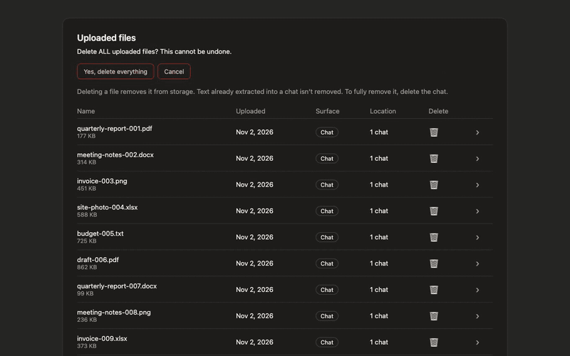
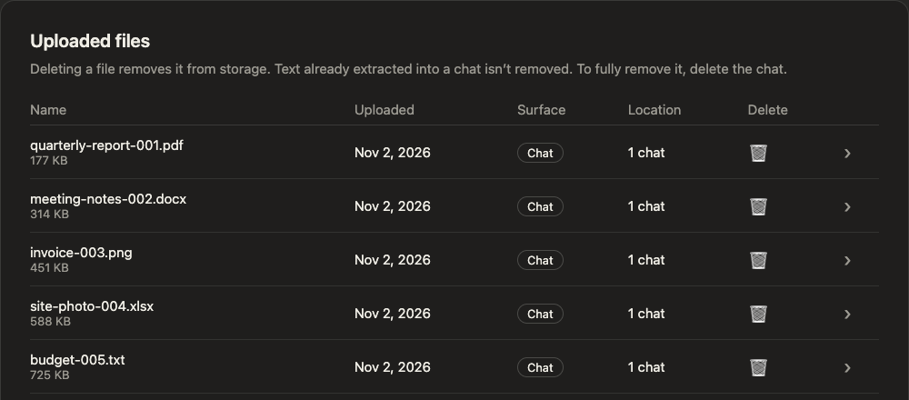

# Uploads Cleaner for claude.ai

A browser extension that deletes all your uploaded files on claude.ai with one button.



The demo runs on a mock page with 300 dummy files. The mock answers faster than the real claude.ai, so a real run is slower (see Speed).

Not affiliated with, endorsed by or sponsored by Anthropic. Claude and claude.ai are trademarks of Anthropic, PBC.

## The problem

claude.ai lists every file you ever uploaded under Settings > Privacy > Uploaded files. There is a trash icon per row and nothing else: no "select all", no "delete all". Each file needs a click on the trash icon and a second click to confirm. With hundreds or thousands of files, that is hundreds or thousands of double clicks.



## What it does

The extension adds one button, "Delete all uploaded files", to that page. After a second confirmation it clicks through the list for you: trash icon, confirm, next file. When a page of files is empty, it loads the next one. It shows how many files are gone, how long it took and how fast it goes. You can stop it at any time.

| Step                                 | What you see                                                                           |
| ------------------------------------ | -------------------------------------------------------------------------------------- |
| 1. Click "Delete all uploaded files" | An inline question: "Delete ALL uploaded files? This cannot be undone."                |
| 2. Click "Yes, delete everything"    | A live line with count, time and files per second, plus a Stop button                  |
| 3. Wait                              | "Done: N files deleted in mm:ss." Or "Stopped: N files deleted." after a click on Stop |

## Install

### Firefox

Install it from addons.mozilla.org: `<AMO_URL>`

### Chrome, Brave, Edge and other Chromium browsers

These browsers only install extensions from their stores. Until a listing exists, you load the extension from a folder:

1. Open the [latest release](https://github.com/hbertsch/claude-uploads-cleaner/releases/latest) and download `uploads-cleaner-<version>-chrome.zip`.
2. Unzip it into a folder you keep.
3. Open `chrome://extensions` (in Edge `edge://extensions`, in Brave `brave://extensions`).
4. Switch on "Developer mode".
5. Click "Load unpacked" and select the unzipped folder.

Chrome may show a warning about extensions in developer mode when it starts. Updates are manual: download the new zip, replace the folder and click the reload icon on the extension.

## Usage

1. Open claude.ai, then Settings > Privacy > Uploaded files. The URL ends with `#settings/data-privacy-controls/uploaded-files`.
2. Click "Delete all uploaded files" and confirm.
3. Keep this tab visible until "Done" appears. Browsers slow down hidden tabs.

Deleting a file removes it from storage. Text that claude.ai already extracted into a chat stays in that chat. To remove it, delete the chat.

## Speed

I measured the real claude.ai page on 2026-11-02 (English interface, 60 dummy files in 3 chats, one session, same tab). The time runs from the click on "Yes, delete everything" to the last removed row.

| Version                                       | Files | Time per file |
| --------------------------------------------- | ----- | ------------- |
| First script (fixed pauses of 0.7 s per file) | 20    | 0.857 s       |
| This extension (waits until the row is gone)  | 20    | 0.115 s       |

That is about 7 times faster. A full run of 60 files took 4 seconds. At 0.115 s per file, 1,000 files would take about two minutes. That figure is a calculation, not a measurement: the real page was never tested with more than 60 files. It also pauses after every page of 50 files, and I measured that pause only once (about 2.3 s). The details and the method are in [docs/dom-notes.md](docs/dom-notes.md).

## How it works

- The extension clicks the same buttons you would click. It does not call any claude.ai interface behind the scenes, and it deletes one file at a time.
- It finds the page by the URL and by the structure of the list, never by button labels. That is why it does not depend on the interface language.
- It sends no data anywhere. The code has no network calls and the extension asks for no permissions. It runs only on `https://claude.ai/*`. See [PRIVACY.md](PRIVACY.md).
- If it does not recognise the page, it shows "Layout not recognised. Nothing was deleted." with a link to report it.
- If claude.ai stops accepting deletions, it retries a few times with growing pauses and then stops with a message.

## Tested on

| Browser                                    | How                                                                                       |
| ------------------------------------------ | ----------------------------------------------------------------------------------------- |
| Chromium 156 (Playwright 1.64.1, headless) | Automated tests on every change: mock page built from the real page, up to 1,000 files    |
| Chrome (real claude.ai, English interface) | Script injected by hand, 60 dummy files, 2026-11-02. The installed extension was not used |
| Firefox                                    | Only linted with `web-ext lint` (0 errors, 0 warnings). Not run                           |
| Brave, Edge                                | Not tested yet                                                                            |

## Limits

- Keep the tab visible while it runs.
- The extension's own texts are English only.
- If claude.ai changes the address of the settings page (the part after `#`), the button disappears without a message. Please open an issue then.
- Other interface languages are checked only with a hand-translated copy of the page and with a test in which every label is replaced by a placeholder. I never saw a real non-English page.
- I never saw a real rate limit or error response from claude.ai. The handling for failures is tested only against an invented mock.
- Text already extracted into chats stays there.

## Development

```
npm ci
npx playwright install chromium
npm test
npm run build
```

`npm test` runs the end-to-end tests against the mock page, `npm run test:unit` the unit tests, `npm run build` writes the zips for Chromium browsers and Firefox into `dist/`. `npm run screenshots` and `npm run demo` recreate the images in this README. How to contribute, and what to do when claude.ai changes its page, is in [CONTRIBUTING.md](CONTRIBUTING.md). Security reports go through [SECURITY.md](SECURITY.md). The changes are listed in [CHANGELOG.md](CHANGELOG.md).

## Licence

MIT. See [LICENSE](LICENSE).
